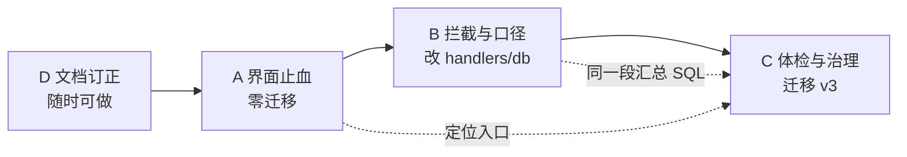

# 记账模块修改计划（2026-10-27）

> **依据**：[`reviews/LEDGER_REVIEW_2026-10-27.md`](../reviews/LEDGER_REVIEW_2026-10-27.md)（2 阻断 / 5 错账缺口 / 4 口径 / 15 项交互与可理解性 / 2 处文档漂移）。
> **范围**：`src/modules/ledger/**`、`src/lib/{ledger,ledgerImport,partyLedger}.ts`、`electron/ledger-{db,handlers}.ts`、`scripts/ledger-*.mjs|cjs`、`docs/plans/LEDGER_PLAN.md`。
> **前提**：数据层四项硬骨头（分摊单点实现 + 守恒断言、结算金额不可手填、结算行部分唯一索引、已结算字段前后端同一判据）**审查确认正确，本计划不碰**。逐条对照见审查 §6。

---

## 0. 一页结论

**四批，共 24 项；第一批 12 项零迁移、只改界面与文案，可一次发版把「不可用」和「假绿灯」清掉。**

| 批次 | 内容 | 是否动主进程 | 是否迁移 | 项数 | 门禁 |
| --- | --- | --- | --- | --- | --- |
| **A** 界面止血 | 2 个阻断 + 3 处"点了没反应" + 主流程断点 + 术语/键盘 | ❌ | ❌ | 12 | `vue-tsc` · `build` · `ledger:ui` |
| **B** 拦截与口径 | 5 处错账缺口 + 3 处数字口径 | ✅ | ❌ | 7 | + `tsc -p tsconfig.electron.json` · `ledger:smoke` · `vitest` |
| **C** 体检与治理 | 体检④ 改真、作废恢复、导入批次撤销、`merged_to`、`rowNo` | ✅ | ✅ v3 | 4 | + 真库备份 + `ledger:smoke` 迁移用例 |
| **D** 文档订正 | FR-17 / FR-07 / §9 三条与实现相反或未落地的描述 | ❌ | ❌ | 3 | `verify:docs` |



**为什么 B 必须在 C 之前**：B5 改「其中公共」、C1 改体检，落在 `ledger-db.ts` 的同一个 `getSummary()` 函数里；同一段 SQL 分两次改，第二个人会看见"字段刚删又加"。

**为什么 A 不混进 B**：A 全是界面改动，出问题回滚一个 commit 就能恢复止损；一旦与 `idList` 上限、导入查重混在一起回滚，会把"止血"一起撤掉。

---

## 1. 裁定原则（先定，避免边做边改口径）

1. **数据层四项不"顺手优化"**：结算金额不可手填、分摊只由 `lib/ledger.ts` 生成、结算状态不落库、上限按同方向余额。任何一项在修 bug 时被"简化"，等于重开一次已收口的设计。
2. **口径字段一次性替换，不并存**：`sharedCents` → `sharedIncomeCents` + `sharedExpenseCents` 这种改动，同一次提交里改完 UI / 单测 / 冒烟断言，不留兼容分支（留分支必然出现两套数字）。
3. **拦截放服务端**：导入查重、批量上限、已结算字段锁，判据写在主进程，界面只负责提前告知。界面拦得住、服务端拦不住，等于没拦。
4. **文案不引入新术语**：统一词表见 A10，新文案只能从表里选词。
5. **每项自带"会红的守卫"**：新增/修改拦截必须给出"改坏哪一行会红"的变异点；做不到守卫的（如 A2 需要 IPC 注入失败）**显式标注为人工验收**，不假装有守卫。

---

## 2. A 批 · 界面止血（12 项，零迁移）

> 只改 `src/modules/ledger/**` 与 `src/lib/ledger.ts`（新增纯函数），不动 `electron/**`。一次发版。

### A1　点过「全部」之后「记一笔」不可用（P0-1）　复杂度：中

- **改法**
  1. `src/lib/ledger.ts` 新增纯函数（可单测）：
     ```ts
     export function defaultBizDate(month: string, today: string): string {
       const m = /^\d{4}-\d{2}$/.test(month) ? month : today.slice(0, 7);
       return m === today.slice(0, 7) ? today : `${m}-01`;
     }
     ```
  2. `EntryEditor.vue:544-547` 的 `defaultDate()` 改为 `defaultBizDate(props.month, localDayKey())`。
  3. `EntryEditor.vue:819` `loadEligible()` 的 `if (!p) return;` 改为 `const p = period.value || localDayKey().slice(0, 7);`（双保险：日期框被别的原因清空时公共区不再报"没有可分摊店铺"）。
  4. `EntryEditor.vue:41-42` 的"当前在看 all"提示改为按 A10 词表的一句话，并与 `LedgerView.vue:1002` 的实际行为一致（不自动切月就别说会切）。
- **验收**：`tests/ledger.spec.ts` 新增 3 例 —— `('all', '2026-10-27') === '2026-10-27'`、`('2026-09', '2026-10-27') === '2026-09-01'`、`('2026-10', '2026-10-27') === '2026-10-27'`。
- **变异**：删掉 `defaultBizDate` 的正则回落，改为直接 `` `${month}-01` `` → 第一例必须红。
- **前置**：手工在真机点一次「全部 → 记一笔」复现（审查 §8 已注明"点击后不可用"是代码路径推断）。

### A2　台账读取失败反显「对账通过」（P0-2）　复杂度：低

- **改法**：`PartyLedger.vue:242-247` 的 catch 里补 `loaded.value = false;`；模板把恒等式块的条件从 `v-else-if="loaded"` 改成 `v-else-if="loaded && identity"`。
- **验收**：失败态只出现红色错误条 + 「重试」按钮，**页面任何位置都不出现"对账通过"**。
- **守卫**：`ledger-ui-smoke.mjs` 若能让 `partyLedger` 通道返回失败，则加一条"拒绝后不含『对账通过』"的断言；做不到就列为**人工验收**（在本计划 §11 勾选项里注明）。

### A3　单店页下拉不显示当前店（P1-7）　复杂度：低

- **改法**：`ShopView.vue:33` 的 `<select>` 加 `:value="shopId"`；`onShopPick` 里 `shopId = Number(($event.target as HTMLSelectElement).value) || 0`；`shops` 里找不到当前 `shopId`（店被删/归档）时补一个 `当前店铺（已不可选）` 的禁用占位，避免出现"有数据但下拉空白"。
- **验收**：重启应用、切到别的页签再切回单店，下拉显示的都是数据区那家店。

### A4　汇总切月显示上月数字（P1-8）　复杂度：低

- **改法**：`SummaryView.vue:237` `refresh()` 在 `await` 之前 `data.value = null`；模板的 `v-if="loading && !data"` 改成 `v-if="loading"` 并给骨架块固定高度（避免清空后页面跳动）。
- **验收**：点 `‹` 的同一帧内，metabar 数字变成占位，不出现"新月份标题 + 旧数字"。

### A5　结算被拒时原因看不见（P1-9）　复杂度：低

- **改法**：`SettlementDialog.vue:376` catch 里同时 `toast(msg, 'error')`；错误块从 `wb-dialog__body` 头部移到 footer 之上，并在 `nextTick` 后 `scrollIntoView({ block: 'nearest' })`。
- **验收**：构造一次超额结算，点击「生成结算单」→ 立刻看到 toast，且弹层内错误块在按钮上方可视区。

### A6　主数据加载失败被静默吞掉（P1-10）　复杂度：中

- **改法**：`useLedger.ts` 新增 `masterError` ref；`loadMasterData()` 里去掉 `api.shops().catch(() => [])`；`init()` 的 catch 写 `masterError`；`load()` 开头**只清自己的** `error`，不清 `masterError`；模板在筛选条下方给一条独立红色横幅（`data-act="master-error"`，带「重试」调 `loadMasterData`）。
- **验收**：把 `ledger:categories` 通道改成 reject → 页面显示"科目/相关人读取失败：…"，不再出现"下拉全空但页面一片正常"。

### A7　台账页脚「0 = 已结清」（P2-14）　复杂度：低

- **改法**：`PartyLedger.vue:136` 文案改为按 A10 词表："「未结清」= 净往来 + 已结算；负数 = 我欠对方。**0 可能是已结清，也可能是可收与可付正好抵消，请看「可收 / 可付」两列**"。同时 `netCents === 0 && (receivable > 0 || payable > 0)` 的行在净往来单元格加一枚「对冲」标记（灰字，不新增图标）。
- **验收**：造 应收 1000 / 应付 1000 的相关人，页脚不再让人读成"两清"。

### A8　主流程第四步「发现记错人后改挂」补齐入口（审查 §5）　复杂度：高

三个入口，都复用 `RepatchDialog.vue`（入参 `entryIds`，已具备）：

1. `PartyDrawer.vue:153-165` 页脚补 `变更相关人`（`data-act="drawer-repatch"`）：`entryIds` = 该人 `status==='active'` 且未结算的条目 id；为 0 时按钮禁用并给出原因「没有未结算条目；已结算的需先撤销结算」。
2. `LedgerView.vue` 明细行：未结算行的编辑弹层里给「改挂到别的相关人」按钮；**已结算行的禁用提示不能只说"先撤销结算"**，改为直接给「变更相关人（撤销结算后改挂）」按钮，点开即 `RepatchDialog([该行])`（此时弹层按 B4 只给出 C 路并红字披露将作废哪张结算单）。
3. `PartyDrawer.vue` 行首复选框 → 选中后底部出现「变更相关人（已选 N 条）」，与明细页批量条同一行为。

- **验收**（用户视角，不看文档）：记一笔 → 按人查欠款 → 结清 → **从抽屉点两次**完成改挂。
- **守卫**：`ledger-ui-smoke.mjs` 加两条 `data-act` 存在性断言（`drawer-repatch`、`entry-editor-repatch`），并断言"零未结算时按钮为 disabled 且 title 非空"。

### A9　六个筛选不落盘（审查 §5-10）　复杂度：低

- **改法**：`useLedger.ts` 的 `persist()` 补齐 `shopId / categoryId / partyId / scope / settleStatus / includeVoid / shopViewId`（`LedgerPrefs` 已声明，只是没写）；`init()` 已回填，无需改。**`keyword` 不落盘**（临时搜索词，落盘会让用户以为"条目丢了"）。
- **验收**：设 4 个筛选 → 重启 → 筛选复原、条目数一致。

### A10　术语统一词表（审查 §5-1/2/3）　复杂度：低

| 概念 | 唯一叫法 | 禁用 |
| --- | --- | --- |
| 条目归属店铺 | **本店**（提示里可写"只记这一家店的账"） | 专属、这家店、单店（"单店"保留给视图名） |
| 多店分摊 | **公共（多店分摊）** | 公共开支、公摊 |
| 条目状态 | **未结算 / 已结算** | 未结清（那是余额） |
| 余额 | **未结清**（负 = 我欠对方） | 已结算（不要用来表示余额） |
| 汇总净额 | **结余**（收入 − 支出） | 利润 |

同时改 `PartyManager.vue:93`：合并说明里的"已结算条目按「结转」处理"与实现相反（`ledger-db.ts:1688-1700` 只改挂未结算、不写结转），改为"已结算条目留在原相关人名下，不随合并转移"。

- **验收**：`grep -rn "专属" src/modules/ledger/` 只剩 `labels.ts` 内部枚举注释；`tests/uxEntryNames.spec.ts`（已有悬空入口名守卫）跟着更新。

### A11　键盘可达与 Esc（审查 §5-11/12）　复杂度：中

- **改法**：新增一个弹层可访问性 composable（`useDialogA11y`，与四个弹层同目录，挂载时记 `document.activeElement`、焦点陷阱、`Esc` 关闭、卸载还原焦点），四个弹层（`EntryEditor` / `SettlementDialog` / `RepatchDialog` / `LedgerImportDialog`）统一接入；遮罩 `@click.self` 改为"未填写内容才关"，`RepatchDialog`（原因必填）与 `LedgerImportDialog`（已选行）**一律不因点遮罩关闭**；明细行 `LedgerView.vue:229`、台账行 `PartyLedger.vue:53` 补 `tabindex="0" role="button"` + `@keydown.enter`。
- **验收**：Tab 循环不跑出弹层；Esc 关闭后焦点回到触发按钮；含已填原因的改挂弹层点遮罩不丢内容。

### A12　体检项缺定位入口（审查 §5-13）　复杂度：中

- **改法**：`SummaryView.vue:119-121` 把 `allocationGapCents` / `partyGapCents` / `brokenEntries` 都做成可点：点 `brokenEntries` 展开"问题条目"清单（id + 日期 + 金额 + 原因），点单条 `emit('open-entry', id)`；`LedgerView.vue` 接住后按 id 打开编辑弹层（`EntryEditor` 已支持 `:id`）。`partyGapCents` 的定位依赖 C1 落地后才真有内容，**先做入口，C1 落地后才有数据**。

---

## 3. B 批 · 拦截与口径（7 项，改 handlers / db / 纯函数）

> 每项都要重跑 `ledger:smoke` + `ledger:ui`。

### B1　导入「全选」勾进疑似重复行（P1-3）　复杂度：低

- **改法**：把 `LedgerImportDialog.vue:516-524` 的逻辑提成 `src/lib/ledgerImport.ts` 的纯函数：
  ```ts
  export function selectAllOk(rows: readonly LedgerImportRowResult[], allOn: boolean): number[] {
    return rows.filter((r) => r.ok && !r.duplicate).map((r) => r.rowNo); // 疑似重复不参与"全选"
  }
  ```
  按钮文案变为「全选（跳过 N 行疑似重复）」，旁边给一个低频的「仍要包含疑似重复」；两个动作都写清楚会勾多少行。
- **验收**：`tests/ledgerImport.spec.ts` 新增 3 例（全选跳过 duplicate / `allOn=true` 时不勾 duplicate / 无 duplicate 时行为不变）。
- **变异**：把 `!r.duplicate` 去掉 → 第一例必须红。

### B2　公共条目在库里永远查不到重复（P1-4）　复杂度：高

- **改法**（保持"一套指纹算法"，不新增第二套判据）
  1. `src/types.ts` 的 `LedgerEntryRow` 加可选 `allocations?: Array<{ shopId: number; amountCents: number; ratioBp: number }>`。
  2. `electron/ledger-db.ts` 的 `listEntries()` 支持 `includeAllocations`，为 `scope='shared'` 的条目用**一条** `bk_allocations` 批量查询补上（不逐条 `entryDetail`，避免 N 次取数）。
  3. `electron/ledger-handlers.ts` 透传该开关（`ledger:entries`）。
  4. `src/lib/ledgerImport.ts:970-985` 去掉 `if (r.scope !== 'shop' || ...) continue;`，改为：有 `allocations` 就按它算指纹，无 `allocations`（未请求）则跳过 —— **保持"只漏报不误报"的既有承诺**，注释同步改。
  5. `LedgerImportDialog.vue:715` 的 `api.entries({...})` 带上 `includeAllocations: true`。
- **验收**：真库造 3 条公共条目 → 导入同内容表 → 3 行全部 `duplicate`、默认不勾；变异测试：把 `includeAllocations` 置 false，用例必须红（证明守卫真的走了新路径）。
- **风险**：`tests/ledgerImport.spec.ts:680` 现有一条**断言"shared 不进指纹"**的用例 —— 这正是把缺陷写成了规格，随本项改写为"shared 有 allocations 时进指纹"。

### B3　批量结算/改挂静默截断 500 条（P1-5）　复杂度：低

- **改法**：`electron/ledger-handlers.ts:83-93` 的 `idList()` 上限提到 **2000**（与 `useLedger.ts:162` 的 `limit: 1000`、`entries` 上限对齐留一倍余量），并且**去重后超限直接抛错**："一次最多处理 2000 条，请缩小范围后重试"。不再静默 `break`。
- **验收**：`ledger:smoke` 加一项"传 2001 个 id → 返回失败且错误文案含上限"；传 2000 个 → 成功。
- **变异**：把抛错改回 `break` → 该冒烟项必须红（旧实现会返回成功，这正是要拦的）。

### B4　全已结算时自动预选「撤销结算后改挂」（P1-6）　复杂度：中

- **改法**：`RepatchDialog.vue:277-280` 的兜底顺序去掉 `'void-then-move'`，且 `preferredMode` 返回 `''`（不预选）而不是 `p.recommended`；`mode` 类型放宽为 `LedgerRepatchMode | ''`；`submitHint` 在无预选时给"所选条目全部已结算，只能撤销结算后改挂"；C 路按钮加红字标签"会作废 N 张结算单"（`voidedTotalCents` 已有，配套给张数）。
- **验收**：单测（把 `preferredMode` 提成纯函数，放 `RepatchDialog` 同目录的 `repatchMode.ts`）3 例：全已结算 → `''`；全未结算 → `'move-all'`；混合 → `'move-unsettled'`。
- **变异**：把 `'void-then-move'` 放回兜底顺序 → 第一例必须红。

### B5　「其中公共」收支混加（P2-11）　复杂度：中

- **改法**：`electron/ledger-db.ts:2414-2418` 的 `shared` 查询按 `kind` 拆成 `sharedIncomeCents` / `sharedExpenseCents`（`sharedCents` **删除**，不留兼容）；`src/types.ts` 的 `LedgerSummary` 同步；`LedgerView.vue:72-74` 展示改为"其中公共 收 ¥x · 支 ¥y"；`tests/ledger.spec.ts` 与 `ledger-ui-smoke.mjs` 的断言一起改。
- **验收**：造 公共收入 5000 + 公共支出 8000 → 显示"收 ¥50 · 支 ¥80"，不再出现一个 13000 的混加数。
- **收尾**：`grep -rn "sharedCents" src/ electron/ tests/ scripts/` 必须为 0。

### B6　批量条「金额合计」收支混加（P2-12）　复杂度：低

- **改法**：`LedgerView.vue:625` 拆成 `selectedIncomeCents` / `selectedExpenseCents`，批量条显示"已选 N 条 · 收 ¥x · 支 ¥y"；结算前的确认弹层复用同一组数（不复算）。

### B7　抽屉逐行余额不含承接、超 1000 条从 0 起算（P2-15）　复杂度：中

- **改法**：`src/lib/partyLedger.ts:172` `runningUnsettled(events, baseCents = 0)` 增加起始余额参数；`PartyDrawer.vue:338` 传 `ledger.transferCents`，使最后一行 == 顶部「未结清」；`PartyDrawer.vue:359` 当 `entries.length === 1000` 时显示"仅显示最近 1000 条，余额从最早可见行起算"（不假装完整）。
- **验收**：`tests/partyLedger.spec.ts` 新增 3 例：`base=0` 行为不变、`base=transferCents` 时末行等于 `unsettledCents`、`base` 为负时符号正确。
- **变异**：把 `baseCents` 恒当 0 → 第二例必须红。

---

## 4. C 批 · 体检与数据治理（4 项，含迁移 v3）

### C1　体检④ `partyGapCents` 恒为零（P2-13）　复杂度：中

- **改法**：`electron/ledger-db.ts:2509-2513` 的 `netRow` 改为 **INNER JOIN `bk_parties`** 后再求和：
  ```sql
  SELECT COALESCE(SUM(CASE WHEN e.kind='income' THEN e.amount_cents ELSE -e.amount_cents END),0) AS net
  FROM bk_entries e JOIN bk_parties p ON p.id = e.party_id
  ${whereSql}
  ```
  `partyGapCents = incomeCents - expenseCents - net`；同时把 `party_id` 越界/悬空的条目加入 `brokenEntries`（`LEFT JOIN ... WHERE p.id IS NULL`），这样 A12 的定位入口才有东西可点。
- **验收**：真库造一条 `party_id` 指向不存在 id 的条目 → `partyGapCents ≠ 0` 且 `brokenEntries` 含它；**旧实现在同一数据下返回 0**（对照记录写进 `ledger:smoke`）。
- **变异**：把 JOIN 改回不带 parties 的写法 → 该冒烟项必须红。这是全计划**唯一能证明"体检项真的会红"**的一条，务必做变异。

### C2　作废条目不可恢复（审查 §5-5，方案 §9 承诺）　复杂度：中

- **改法**：新增通道 `ledger-entry-restore`（三处同步：`electron/preload.ts` / `src/types.ts` 的 `ElectronAPI` / `src/core/services/ipc.ts` 的 `ElectronApi`；**漏第三处只有 `vue-tsc` 能拦**）；数据层校验：只允许 `status='void' → 'active'`，且该条目当前不得被任何 `active` 结算行占用；明细页在 `includeVoid` 开启时对作废行给「恢复」按钮，确认文案写明"恢复后重新计入合计与往来"。
- **验收**：作废 → 恢复 → 合计与相关人余额回到作废前**同值**（断言用真库前后对比，不比界面）。

### C3　导入无撤销（审查 §5-5）　复杂度：中

- **轻量版（本批做）**：导入返回 `createdIds`，导入完成页给「撤销本次导入（N 条）」，走一次批量作废；只在本次会话有效（切页/重启后失效），文案写明这一点。
- **完整版（待拍板 D4）**：`bk_entries.import_batch_id` 迁移 + 导入历史列表，支持跨会话撤销。

### C4　已并入 vs 手动停用不可区分（审查 §5-4）　复杂度：中，**待拍板 D5**

- **改法**：`bk_parties` 加 `merged_to INTEGER NOT NULL DEFAULT 0`（SQLite 加列可 `ALTER TABLE ADD COLUMN`，不改 CHECK 就不用重建表）；`ledgerPartyMerge` 落该值；台账与合并列表显示「已并入 → B」并可跳转；手动停用仍显示「已停用」。
- **回滚**：迁移前 `cp -cR <真实 userData> <临时>` 备份；失败只影响新增列，旧列不动。

### C5　导入报"第 N 行"不是 Excel 行号（审查 §5-6）　复杂度：低

- **改法**：解析层 `rowNo` 一路透传到 `electron/ledger-handlers.ts:199-225` 与 `ledger-db.ts:2803/2829` 的错误文案；同时把"缺「相关人」列"从逐行报错改成一条列级错误（`lib/ledgerImport.ts:812` 已有方向列的专门分支可对照）。

---

## 5. D 批 · 文档订正（3 项，先做，10 分钟）

1. `plans/LEDGER_PLAN.md` **FR-17** 删除"生成 1 条结转记录"，改为与 §6.4 修正一致（B 路不写结转）。
2. `plans/LEDGER_PLAN.md` **FR-07** 的"作废后分摊行删除"改为"分摊行保留、只置 `status='void'`"（金额查询全过滤 `active`，故无金额影响；残留行的唯一后果是店铺删除保护会拒绝删店，而这个拒绝是有意的）。
3. `plans/LEDGER_PLAN.md` §9 的"恢复作废条目（P2）"在 C2 落地后勾选，不要把未落地写成已落地。

> 理由：`ledger-db.ts:2029-2032` 有"不写结转"的注释，与 FR-17 相反；下一个读 FR 的人会把正确实现当 bug 改掉。

---

## 6. 明确不做（写下来是为了不再讨论）

- 部分核销 / 分次结清（`LEDGER_PLAN.md` §13 已保留该条）
- 月结锁定、预付/借款、跨期调账
- 把「记账」并进「统计」，或让两者数字相加（口径隔离是踩过三次坑换来的）
- 给结算加"手填金额"，或让界面重算分摊
- 把体检提示做成可关闭的引导条
- 为兼容而保留 `sharedCents` 这类"两套口径"的过渡字段

---

## 7. 待拍板

| 编号 | 问题 | 建议 | 影响面 |
| --- | --- | --- | --- |
| **D1** | 批量上限：抬到 2000 还是超限直接拒？ | **两者都要**：抬到 2000 且超限报错（B3） | 只改 handlers，无迁移 |
| **D2** | 「其中公共」拆字段后是否保留 `sharedCents`？ | **删除**，一次性改完（B5） | 本仓无外部消费者，收尾 grep 归零 |
| **D3** | 作废恢复要不要加时间窗（如仅 30 天内可恢复）？ | **不加**：能不能恢复取决于"是否被结算占用"，不取决于时间 | C2 |
| **D4** | 导入撤销：轻量（会话内）够不够？ | 先做轻量；需要跨会话审计再加批次字段 | C3 |
| **D5** | 是否值得为「已并入」加一次迁移（`merged_to`）？ | 值得：现在用户看到"A（已停用）余额 0"，会以为钱丢了 | C4 |
| **D6** | UI 是否统一叫「本店 / 公共」？ | 统一（A10 词表），内部枚举 `shop/shared` 不动 | 全部文案 + `uxEntryNames` 守卫 |

---

## 8. 门禁与验收

```bash
# A 批
npx vue-tsc --noEmit && npm run build && npm run ledger:ui

# B / C 批（改主进程需先编译，否则跑的是旧产物）
npx tsc -p tsconfig.electron.json && npm run verify && npm run build
npx vitest run tests/ledger.spec.ts tests/ledgerImport.spec.ts tests/ledgerPeriod.spec.ts \
  tests/ledgerRevenue.spec.ts tests/partyLedger.spec.ts
npm run ledger:smoke && npm run ledger:ui

# 文档
npm run verify:docs
```

**用户视角的收口判据**（四条同时成立才算修完）：

1. 主流程四步全通：记一笔 → 按人查欠款 → 结清 → 改挂（其中第四步不再需要看文档）。
2. 三处数字对得上：明细合计 = 汇总页收支 = 台账恒等式，且**未来月/无数据月/全部日期**三种边界下都成立。
3. 每个失败路径都有可读原因：结算被拒、导入失败、主数据读取失败、台账读取失败。
4. 每个拦截都有守卫，且**改坏实现会红**（B1 / B2 / B3 / B4 / B7 / C1 各有变异点，见 §2–§4）。

---

## 9. 风险与回滚

| 风险 | 触发点 | 处理 |
| --- | --- | --- |
| B2 改动让导入**误报**重复（用户漏账） | 指纹纳入分摊后签名口径不一致 | 只做"有 allocations 才算"；真库双跑对照（同表导两次全标、改金额不标） |
| B5 删字段漏改消费者 | `sharedCents` 用于冒烟/汇总页 | 收尾 `grep -rn` 归零 + `tsc` 拦类型 |
| C4 迁移写坏 `bk_parties` | 加列本可 `ALTER`，不要重建表 | 迁移前 `cp -cR` 备份；只 `ADD COLUMN`，不 `DROP/RENAME` |
| C1 体检变红后被当成"数据坏了" | 真库确实存在悬空 `party_id` | 上线前先跑一次只读查询，把存量问题在 CHANGELOG 里写清 |
| A 批与 B 批混在一个 commit | 急于"一次改完" | 每批独立提交，提交前 `git status --porcelain` 与 `git diff --cached --name-status` 核对 |

---

## 10. 进度跟踪

| 批次 | 项 | 状态 | 提交 |
| --- | --- | --- | --- |
| D | 文档订正 3 项（FR-07 分摊行保留 · FR-17 B 路不写结转 · 方案原写"生成结转记录"是实现时发现的方案错误） | ✅ 2026-10-27 | 随 A 批 |
| A | A1 全期间日期 · A2 `loaded` · A3 下拉绑定 · A4 切月清数据 · A5 结算错误 · A6 主数据错误 · A7 页脚 · A8 改挂入口 · A9 筛选落盘 · A10 术语 · A11 键盘 · A12 定位入口 | ✅ 2026-10-27 | 界面止血 |
| B | B1 全选 · B2 公共查重 · B3 上限 · B4 不预选 C · B5 公共拆分 · B6 批量分向 · B7 抽屉余额 | ✅ 2026-10-27 | 拦截与口径 |
| C | C1 体检④ · C2 作废恢复 · C3 导入撤销 · C4 `merged_to`（迁移 v3）· C5 行号 | ✅ 2026-10-27 | 体检与治理 |

> A 批建议先做 A1/A2 两项并单独提交（这两项决定"能不能用"），其余 10 项可同批发版。

### 10.1 实施记录（2026-10-27 收工）

四批 24 项全部落地，门禁逐条通过：`vue-tsc --noEmit` / `tsc -p tsconfig.electron.json` / `build` /
`verify` / `vitest run`（172 例，6 个记账 spec）/ `ledger:smoke` / `ledger:ui`（宽 + 窄两遍）。

实施中发现并当场修掉的三处**计划外**问题（都属于"照计划抄会写错"的那类）：

| 问题 | 现象 | 处理 |
| --- | --- | --- |
| `bk_entries.voided_at` 是 `NOT NULL DEFAULT ''` | C2 恢复写 `voided_at = NULL` → `NOT NULL constraint failed`，恢复**永远失败** | 清空写回空串；`ledger:smoke` 新增"作废 → 恢复 → 合计回同值"用例兜住 |
| SQL 注释里出现反引号 | `merged_to` 的列注释写在模板字符串里，反引号提前结束字符串 → `TS1005` | 注释里不写反引号；`tsc` 直接拦下，未进产物 |
| 导入"第 N 行"用的是批内序号 | 勾选子集后 `i + 1` 指向别人的那一行 | `rowNo` 从解析层一路透传到 `batchCreateEntries`；不带时回落批内序号（老调用方不退化） |

另有两处**取舍**要留档：

- **C3 只做轻量版**（`createdIds` + 会话内撤销条），完整版（`import_batch_id` + 导入历史列表）仍待拍板 D4。
  界面文案明写"只在本次打开应用期间有效" —— 不写就会让人以为以后还能回来撤，从而不再核对文件。
- **C4 不回填历史合并痕迹**：老库 `archived=1` 分不清是手动停用还是当时合并的结果，
  猜错会把"手动停用的人"标成"已并入某人"，比不显示更难查。故迁移只加列，历史行一律 `merged_to=0`。
